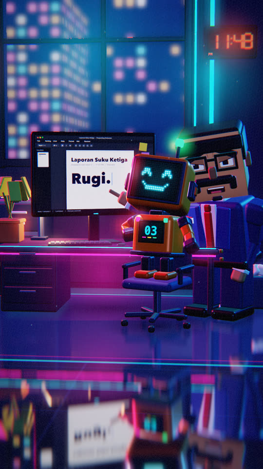

# Set s1-kotak: "Pejabat"

**Teknik:** dunia 3D daripada kotak-kotak bersudut (bevel), macam robot mainan. Pejabat malam yang gelap (charcoal dan indigo), cahaya monitor sejuk sebagai lampu utama, lampu neon cyan dan magenta di tepi watak, kabus nipis, lantai berkilat, dan latar belakang yang digelapkan untuk kesan kedalaman medan (depth of field palsu).



> Nota kit: hanya `stories/s1-e1.json` disertakan. Episod lain yang disebut di bawah (e2, e3 dan seterusnya) tidak ada dalam kit; salin e1 dan ubah. Lokasi dan action tambahan yang disebut tetap tersedia. Suara: `npm run video -- <id>` guna `VOICE_PROVIDER` dalam `.env` (percuma, ElevenLabs atau Gemini).

## Watak

| Kunci | Watak | Rupa | Perangai | Suara |
|---|---|---|---|---|
| `bos` | Bos Rahman | Tinggi dan berkotak, sut biru tua, tali leher merah, cermin mata segi empat, kening tebal, misai. Kepala segi empat dengan muka yang boleh bertukar rupa. | Tak sabar, cepat naik angin, suka kata "ringkas". | Dalam, garau, laju dan tegas (Gemini: Algenib) |
| `intern` | Intern-3 | Robot intern AI yang kecil, badan oren, kepala kiub dengan skrin gelap, mata dan mulut piksel cyan yang bercahaya, antena berlampu. | Rajin, bangga, ikut arahan bulat-bulat (literal). | Cerah, ceria, tepat macam robot (Gemini: Puck) |

## Lokasi dan prop

- **Lokasi:** `pejabat` (pejabat malam, jam 11:48 PM, tingkap bandar), `mamak` (kedai mamak malam), `rumah` (ruang tamu rumah bos lewat malam), `bilik_mesyuarat` (bilik mesyuarat lepas tengah malam).
- **Prop skrin:** monitor besar. Skrin ini dilukis sebagai kanvas supaya teks tajam dalam shot `screen`.
- **Jenis skrin (`type`):** `doc`, `post` dan `prompt`.

```json
"screens": {
  "kosong": { "type": "doc", "title": "Laporan Suku Ketiga", "body": "" },
  "rugi":   { "type": "doc", "title": "Laporan Suku Ketiga", "body": "Rugi." },
  "promosi": { "type": "post", "caption": "Promosi Hujung Bulan", "image": "product", "views": "38", "likes": "2" },
  "arahan": { "type": "prompt", "lines": ["Peranan: penganalisis kewangan", "Tugasan: laporan suku ketiga", "Format: 5 poin, 1 muka surat"] }
}
```

- `doc`: dokumen dengan `title` dan `body` (`meta` pilihan, contohnya "Muka 1 daripada 214").
- `post`: pos media sosial dengan `caption`, `views`, `likes`.
- `prompt`: kotak arahan AI; `lines` ialah baris-baris arahan.
- Bila `action` ialah `type` dan skrin berubah daripada baris sebelumnya, teks baharu ditaip perlahan-lahan dengan kursor.

## Shot yang disokong

`wide`, `two`, `bos`, `intern`, `ots_screen` (di belakang bahu, skrin kelihatan), `screen` (skrin penuh). Shot lain jatuh balik ke `two`.

## Action yang disokong

| `action` | Kesan |
|---|---|
| `type` | Intern menaip di monitor (skrin ditaip bila `screen` berubah). |
| `boss_types` | Bos yang menaip. |
| `point_screen` | Bos menuding ke skrin. |
| `slam_desk` | Bos hentak meja. |
| `printer_spew` | Pencetak memuntahkan kertas tanpa henti. |
| `rub_eyes` | Gosok mata (penat). |
| `look_clock` | Pandang jam dinding. |

Action yang tidak dikenali diabaikan. Muka yang boleh digunakan (`face` / `listener`): `neutral`, `happy`, `annoyed`, `shocked`. Dalam _silent beat_, `face` ialah Bos dan `listener` ialah Intern.

## Cara buat episod baru

1. Salin contoh: `stories/s1-e1.json` ke `stories/s1-e2.json`.
2. Ubah `id`, `title`, `screens` dan `lines`. Setiap baris ada `who` (`bos` / `intern` atau `null` untuk _silent beat_ dengan `dur`), `text`, `face`, `listener`, `shot`, `screen`, `pause` dan `action` (pilihan). Cadangan: 8 hingga 12 baris, ~100 patah perkataan, satu _silent beat_, dan punchline yang mengulang sesuatu daripada awal.
3. Semak dulu: `npm run check -- s1-e2`, buka `out/s1-e2-sheet.jpg`.
4. Render: `npm run video -- s1-e2`. Hasil: `out/s1-e2.mp4`.

Contoh siap: `stories/s1-e1.json` ("Ringkas"). Pengajaran: AI ikut arahan bulat-bulat; "ringkas" tanpa had panjang jadi satu perkataan.
